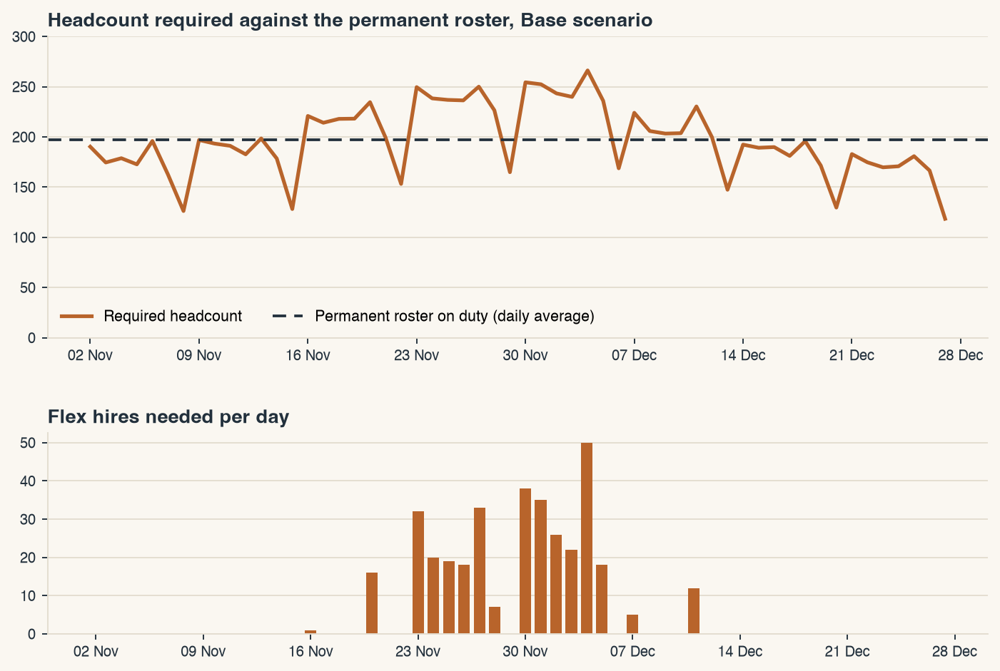

# Fulfilment Labour Plan

Excel workbook that turns an eight-week outbound forecast for a fulfilment centre into a daily labour plan: how many people the site needs, how many the permanent roster covers, and what the gap costs to close with overtime and flex hires.

The inputs are illustrative planning assumptions for a generic site. They are not data from any real employer.

## The logic

1. Daily units become labour hours for four processes (stow, pick, pack, ship) using units-per-hour standards.
2. Hours become required headcount after breaks, indirect time and absenteeism.
3. The permanent roster is used first. Any shortfall goes to overtime, capped per person and by take-up, and then to flex hires, who are slightly less productive.
4. Cost is regular wages, overtime at double rate and flex agency wages. Each day shows cost per unit, roster utilisation and the action required.

## Results on the delivered inputs

| Scenario | Demand | Units | Total cost (INR) | Cost per unit | Peak flex hires | Days needing flex |
|---|---|---|---|---|---|---|
| Base | x1.00 | 3,088,100 | 10,238,039 | 3.32 | 50 | 16 |
| Peak | x1.30 | 4,014,530 | 13,631,300 | 3.40 | 137 | 46 |
| Low | x0.85 | 2,624,885 | 9,346,693 | 3.56 | 7 | 1 |

Excel's recalculation of the workbook matches an independent Python model of the same rules in all three scenarios.

## What is in the folder

| Path | Contents |
|---|---|
| `FulfilmentLabourPlan.xlsm` | Dashboard, Inputs, Plan (56 days), ShiftPlan, Weekly. Every calculation is a live formula; the macros are built in |
| `vba/modLabourPlan.bas` | Macro source: scenario buttons, input check, scenario comparison, PDF export of the dashboard |
| `build/build_xlsx.py` | Generates the workbook and the reference figures above |
| `build/vba_project.py` | Packs the `.bas` source into the workbook's macro project |
| `build/make_preview.py` | Draws `docs/dashboard.png` from the same model |

## Using it

Open the workbook and choose Enable Macros. Change the Scenario dropdown on Inputs, or any blue input cell, and the plan recalculates. The Dashboard buttons switch scenario, check the inputs, refresh the comparison table and export the dashboard to PDF. Run Compare scenarios once after changing inputs.

The plan sheets are plain formulas, so everything except the buttons works with macros disabled.

To rebuild: `pip install xlsxwriter matplotlib`, then from the project folder run `python3 build/vba_project.py`, `python3 build/build_xlsx.py` and `python3 build/make_preview.py`.

## Assumptions worth challenging

- The permanent pool is cross-trained and can move between processes, so headcount is planned in total, not per process.
- Weekly offs are rotated, so average daily availability is roster x working days / 7.
- Absent associates are unpaid; overtime is paid at 2x.
- Flex hires are counted as whole people per day and paid for a full shift.
